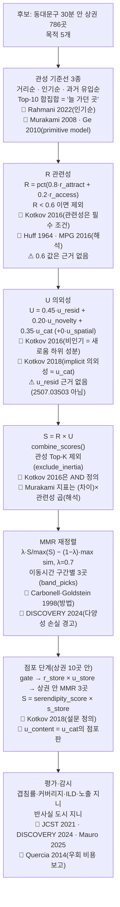

# 선행연구 해설: 어떤 논문이 무엇을 말했고, 우리는 어디에 썼나

작성: 2026-11-03 · 브랜치 `codex/gunwoo/serendipity-papers-explainer`(`codex/gunwoo/serendipity-ranking`에서 분기)

읽는 사람: 추천시스템을 처음 보는 팀원, 교수님, 심사위원.

바탕 자료:

- 상권 단계 설계: `docs/serendipity_recommendation_design.md`(이하 "설계 문서"), 코드 `scripts/build_serendipity_ranking.py`
- 원문 확인 노트: 브랜치 `codex/gunwoo/serendipity-research-notes`의 `docs/serendipity_prior_research_notes.md`(이하 "노트")
- 점포 단계 설계: 브랜치 `codex/gunwoo/store-level-recommendation-options`의 `docs/store_level_recommendation_options.md`(이하 "점포 문서"), `docs/store_level_validation_v0.md`, `data/processed/store_level/README.md`

> **판정 원칙.** 설계 문서와 노트가 다르면 노트를 따른다. 다른 곳은 본문에 "노트와 다름" 또는 "설계 문서와 다름"으로 적었다.
>
> **이번에 새로 확인한 것.** 노트를 쓸 때는 원문 호스트가 막혀 있었다. 이번 세션에서는 일부가 열렸다. Kotkov 학위논문 PDF(2016 서베이 전문이 부록으로 들어 있음), PMC9008453 전문, arXiv 초록 2편, EJTIR 논문 페이지, Crossref 서지를 직접 읽었다. 그 결과 노트의 판정 두 곳을 보완했다(4장 표 아래 B·C행). 나머지 판정은 노트 그대로다.
>
> 확인 수준 표기: **원문** = 본문을 직접 읽음 / **초록** = 초록·출판사 페이지만 / **2차** = 다른 논문·언론의 요약 / **미확인** = 확인하지 못함.

---

## 0. 한 장 요약

### 0.1 우리 추천이 하는 일 (3줄)

1. 동대문구에서 대중교통 30분 안에 닿는 서울 공식 상권 786곳을 후보로 둔다.
2. 목적(식사·카페·쇼핑·여가문화·공부)마다 "갈 만한가(R)"가 충분한 상권만 남기고, 그중 "늘 가던 곳(관성)과 다른가(U)"가 큰 곳을 위로 올린다.
3. 고른 상권 안에서 같은 원리로 점포 3곳을 다시 고른다(점포 단계, `r_store × u_store`).

### 0.2 논문 → 설계 요소 대응표

근거 강도: **직접 근거** = 원문 주장이 우리 설계 요소를 그대로 받친다. **해석·영감** = 방향은 같지만 우리가 바꿔 읽었다. **근거 아님** = 원문이 그 주장을 하지 않거나 반대다.

| # | 논문 | 핵심 주장 한 줄 | 우리 설계의 자리(변수·식) | 근거 강도 |
|---|---|---|---|---|
| 1 | Kotkov, Wang, Veijalainen 2016 (서베이) | 세렌디피티 항목 = 관련 ∩ 새로움 ∩ 의외(세 조건 모두) | 점수 구조: R 하한 + U. `u_novelty`(비인기는 새로움의 하위 성분). 관성 기준선(=primitive model) | 직접 근거 (곱 형태는 근거 아님) |
| 2 | Kotkov, Konstan, Zhao, Veijalainen 2018 | 세렌디피티는 8가지 변형이 있고, 변형마다 만족 효과가 다르다 | 설문 문항(Q1 새로움·Q2 의외성·Q3 관련성), 적중 = 세 조건 AND | 직접 근거 (설문). `u_cat`엔 경고 |
| 3 | Ziarani, Ravanmehr 2021 (JCST 문헌고찰) | 정확도만 보면 과특화된다. 의외성과 관련성을 함께 봐야 한다 | beyond-accuracy 평가 틀(겹침률·커버리지·ILD·지니) | 해석·영감 |
| 4 | Ben Sassi, Järv, Ben Yahia 2024 (DISCOVERY) | 세렌디피티 POI 추천은 정확도는 올리지만 범주 다양성·커버리지는 기준선에 진다 | MMR 단계를 따로 둠, `distinct_area_types`·`catalog_coverage` 상시 보고 | 직접 근거 (감시 지표) |
| 5 | Ge, Chrysanthis, Pelechrinis 2016 (MPG) | 선호·인기·거리를 묶은 관련성 위에서 다양성을 최대화한다 | R(매력도+접근성) → MMR 2단 구조 | 해석·영감 (인기 처리는 반대) |
| 6 | Rahmani, Deldjoo, Tourani, Naghiaei 2022 | POI 추천은 인기 장소에 몰리고 활동 사용자에게 유리하다 | 관성 기준선 `popularity` | 직접 근거 |
| 7 | Forster, Kopeinik, Helic, Thalmann, Kowald 2025 (arXiv 2507.03503) | 인기 보정(CP)은 추천 목록의 인기 분포를 사용자 프로필에 맞춘다 | 설계 문서는 `u_resid`의 근거로 씀 | **근거 아님** (`u_resid`) |
| 8 | Mauro, Minici, Pappalardo 2025/2026 | 위치 추천은 개인 다양성을 올려도 도시 쏠림을 키울 수 있다 | 반사실 시뮬레이션 `counterfactual()`, 도시 유입 지니 감시 | 직접 근거 (문제 제기). 방법은 단순화 |
| 9 | Pappalardo et al. 2015 | 사람은 귀환형(returner)과 탐험형(explorer)으로 나뉜다 | 향후 '탐험 성향' 설정(λ, R 하한) | 해석·영감 |
| 10 | Chowdhury, La Paix, Geurs 2020 | 덜 가는 목적지일수록 개인 안 변동이 크다(새로움 추구로 해석) | 재량 목적에만 적용, 비일상 유입만 사용 | 해석·영감 |
| 11 | Kemperman, Borgers, Oppewal, Timmermans 2000 | 테마파크 선택에 계절성·다양성 추구가 시간에 따라 작용한다 | 라벨 뒤 조건부 로짓에 다양성 추구 항(4.3-3) | 해석·영감 |
| 12 | Quercia, Schifanella, Aiello 2014 | 몇 분 더 걸어도 더 즐거운 경로를 추천할 수 있다 | 관성 대비 추가 거리·도달률 보고 | 해석·영감 |
| 13 | Liang et al. 2022 (PMC9008453) | 우연히 만난 낯선 제품은 위험 지각을 높여 구매 의도를 낮춘다 | 설계 문서는 R 하한 0.6의 근거로 씀 | **근거 아님** (R 하한) |

분포: 직접 근거 5편(1·2·4·6·8), 해석·영감 6편(3·5·9·10·11·12), 근거 아님 2편(7·13). 1번과 2번도 "곱 형태"의 근거는 아니다.

점포 단계와 평가에서 쓴 개념·방법(2장 B에 카드가 있음):

| 개념 | 출처 | 우리 설계의 자리 | 근거 강도 |
|---|---|---|---|
| primitive model 대비 세렌디피티 지표 | Murakami et al. 2008, Ge et al. 2010 | 관성 기준선 3종, 제안 지표 `SRDP@K` | 직접 근거 (정의). 곱 형태는 해석·영감 |
| MMR | Carbonell, Goldstein 1998 | `mmr_rerank()`, 점포 `mmr()` | 직접 근거 (방법). λ=0.7 값은 근거 아님 |
| Huff 모형 | Huff 1964 | R = 매력도·접근성 결합 | 해석·영감 (식은 다름) |
| 목록 내 다양성(ILD) | Ziegler et al. 2005 | `intra_list_diversity`, 점포 `ild()` | 해석·영감 (원문 정의 미확인) |
| 조건부 로짓 | McFadden 1974 | 라벨 뒤 가중치 추정(설계 4.3, 점포 안 C) | 직접 근거 (방법). 아직 추정 안 함 |
| 경험적 베이즈 축소, lift | 통계 일반(특정 논문 없음) | 리뷰 성격 벡터 `shrunk_lift()` | 해당 없음 (표준 기법) |
| 네이버 키워드 리뷰 | 데이터 원천(논문 아님) | `fit`, `u_content`, `u_local` | 해당 없음. v0에서는 수집 실패로 0.5 |

---

## 1. 그림: 추천이 흘러가는 길과 각 칸의 논문



그림이 안 보이는 환경을 위한 글자판:

```
후보 786곳
  └─ 관성 기준선(거리·인기·과거 유입 Top-10 합집합) ........ Rahmani 2022, Murakami 2008·Ge 2010
       └─ R 관련성, R < 0.6 제외 ................................ Kotkov 2016(관련성 필수), Huff 1964(해석)
            └─ U 의외성(u_resid·u_novelty·u_cat) ................ Kotkov 2016·2018 / u_resid는 근거 없음
                 └─ S = R × U, 관성 Top-K 제외 .................. Kotkov는 AND, Murakami는 곱(해석)
                      └─ MMR(λ=0.7), 구간별 3곳 ................. Carbonell·Goldstein 1998, DISCOVERY 2024
                           └─ 점포: r_store × u_store, 상권 안 MMR 3곳 ... Kotkov 2018(설문), u_content
                                └─ 평가: 겹침률·ILD·지니·반사실 ....... JCST 2021, Mauro 2025, Quercia 2014
```

---

## 2. 논문별 카드

### A. 노트의 13편

#### A1. Kotkov, Wang, Veijalainen (2016) — 세렌디피티 서베이

- **서지**: Denis Kotkov, Shuaiqiang Wang, Jari Veijalainen. "A survey of serendipity in recommender systems." *Knowledge-Based Systems* 111 (2016): 180–192. DOI [10.1016/j.knosys.2016.08.014](https://doi.org/10.1016/j.knosys.2016.08.014)
- **무엇을 연구했나**: 추천시스템 논문들이 세렌디피티를 어떻게 정의하고 재는지 정리했다.
- **무엇을 말하나**:
  - 세렌디피티 항목은 관련 있고, 새롭고, 의외인 항목이다. 서베이는 이를 집합의 교집합 `I_ser = I_rel ∩ I_nov ∩ I_unexp`로 적는다.
  - 새로움에는 두 하위 성분이 있다. 비인기(unpopularity)와 사용자 프로필과의 비유사성이다. 인기는 "사용자가 그 항목을 알 가능성"으로 본다.
  - 지표는 성분 지표와 전체 지표로 나뉜다. 전체 지표 대부분은 "단순 기준 추천(primitive model)"과 비교한다(2장 B1).
- **우리가 가져온 것**: ① 세 조건을 모두 만족해야 한다는 정의. ② 비인기를 새로움의 대리변수로 쓰는 근거. ③ 기준 추천과 비교한다는 틀.
- **어디에 어떻게 적용했나**:
  - 관련성 하한: `combine_scores(r, u, r_floor)`가 `R < 0.6`이면 S를 비운다.
  - 새로움: `u_novelty = pct_rank(-lagged_total_sales)`(`add_inflow_residual()`). 직전 분기 상권 총매출이 낮을수록 높다.
  - 의외성: `u_cat = pct_rank(1 − max cos(관성 Top-K))`(`add_unexpectedness()`).
  - 기준 추천: `inertia_rankings()`의 세 목록.
- **원문과 차이·한계**:
  - 원문은 **교집합(AND)**이다. 우리 `S = R × U` 곱은 순위를 내기 위한 근사다. 곱 형태를 원문이 제안하지는 않는다(노트 0-2 #1).
  - 원문의 새로움·의외성은 **개인** 프로필 기준이다. 우리는 동대문구 출발 **집단**의 관성 기준이다.
  - 우리 비인기는 도시 전체 매출 기준이다. 원문의 "다른 사용자 평점 수" 기준과 다르다.
- **확인 수준**: 원문. Kotkov 학위논문(University of Jyväskylä, 2018) 부록에 실린 서베이 전문을 읽었다. [학위논문 PDF](https://jyx.jyu.fi/bitstream/handle/123456789/58207/978-951-39-7438-1_vaitos07062018.pdf?sequence=1)
- **노트와 다름**: 노트는 2016 서베이를 "초록만" 확인했다. 이번에 전문을 읽어 교집합 정의와 비인기 하위 성분을 확인했다.

#### A2. Kotkov, Konstan, Zhao, Veijalainen (2018) — 실제 사용자 응답으로 본 세렌디피티

- **서지**: Denis Kotkov, Joseph A. Konstan, Qian Zhao, Jari Veijalainen. "Investigating serendipity in recommender systems based on real user feedback." *Proceedings of the 33rd Annual ACM Symposium on Applied Computing (SAC 2018)*, pp. 1341–1350. DOI [10.1145/3167132.3167276](https://doi.org/10.1145/3167132.3167276). 데이터: [GroupLens Serendipity 2018](https://grouplens.org/datasets/serendipity-2018/)
- **무엇을 연구했나**: MovieLens 사용자 475명에게, 그들이 높게 평가한 영화 1,689편의 평점 2,146건에 대해 설문했다. 세렌디피티 정의 8가지를 실제 응답으로 비교했다.
- **무엇을 말하나**:
  - 새로움은 2종이다. strict(처음 들음), motivational(들어 봤지만 안 봄).
  - 의외성은 4종이다. relevant(좋아할 줄 몰랐음), find(혼자서는 못 찾았을 것), implicit(평소 보던 것과 다름), recommend(추천될 줄 몰랐음).
  - 2 × 4 = 8가지 세렌디피티. 관련성과 함께라면 모든 변형이 선호를 넓힌다.
  - 만족도는 변형마다 다르다. find > implicit > relevant 순이다. "좋아할 줄 몰랐던 것, 추천될 줄 몰랐던 것"은 본 뒤 덜 즐거웠다.
- **우리가 가져온 것**: 설문 문항 구조와 "세 조건 모두 충족 = 세렌디피티" 규칙.
- **어디에 어떻게 적용했나**:
  - 상권 설문(설계 문서 4.2): ① 몰랐다 ② 예상 밖이다 ③ 가 보고 싶다. 세 문항 모두 4점 이상이면 1.
  - 점포 설문(`docs/store_level_validation_v0.md` 6절): `적중 = Q1 '처음' ∧ Q2 ≤ 2 ∧ Q3 ≥ 4`. Q1은 strict novelty에 가깝고, Q2 "평소 갈 곳으로 떠올렸을까요?"는 find 또는 implicit 의외성에 가깝다.
- **원문과 차이·한계**:
  - 원문은 **이미 본 영화**에 대한 회고 응답이다. 우리는 **아직 안 간 곳**에 대한 의향을 묻는다. 원문의 relevance(본 뒤 만족)와 우리 Q3(가 보고 싶음)는 다르다.
  - 우리 `u_cat`은 "관성 목록과 업종 구성이 다름"이라 implicit 의외성 계열이다. implicit은 relevant보다 만족이 높지만 find보다 낮다. 그래서 `u_cat` 가중치 0.35는 설문으로 확인해야 한다.
- **확인 수준**: 원문(학위논문 3.1.1절의 정의·설문 문장·결과). SAC 논문 자체는 미열람. 초록은 [UMN 페이지](https://experts.umn.edu/en/publications/investigating-serendipity-in-recommender-systems-based-on-real-us/).
- **노트와 다름**: 노트 Top 5 #3은 "implicit 계열(`u_cat`)이 만족을 해치는 변형일 수 있다"고 봤다. 학위논문에서는 implicit이 relevant보다 만족이 **높다**. 만족이 낮은 쪽은 relevant·recommend 변형이다. 초록이 말한 "만족을 해치는 한 변형"이 둘 중 어느 것인지는 미확인이다.

#### A3. Ziarani, Ravanmehr (2021) — 세렌디피티 체계적 문헌고찰

- **서지**: Reza Jafari Ziarani, Reza Ravanmehr. "Serendipity in Recommender Systems: A Systematic Literature Review." *Journal of Computer Science and Technology* 36(2): 375–396, 2021. DOI [10.1007/s11390-020-0135-9](https://doi.org/10.1007/s11390-020-0135-9)
- **무엇을 연구했나**: 세렌디피티 추천 연구의 정의·데이터셋·평가 기법을 체계적으로 정리했다.
- **무엇을 말하나**: 정확도만 강조하면 추천이 과특화되고 지루해진다. 새로움·다양성만으로는 관련성이 보장되지 않는다. 그래서 의외성과 관련성을 함께 봐야 한다.
- **우리가 가져온 것**: 정확도 하나로 평가하지 않는다는 원칙.
- **어디에 어떻게 적용했나**: `beyond_accuracy()`가 관성 겹침률(`overlap_inertia_union`), 커버리지(`catalog_coverage`), ILD(`intra_list_diversity`), 노출 지니(`exposure_gini`), 평균 R을 같이 낸다.
- **원문과 차이·한계**: 원문의 지표 분류표는 확인하지 못했다. 설계 문서 3장의 "오프라인 지표는 사용자 인식과 어긋날 수 있다"는 초록에서 확인되지 않는다(노트 0-2 #12, 판정 보류).
- **확인 수준**: 초록.

#### A4. Ben Sassi, Järv, Ben Yahia (2024) — DISCOVERY

- **서지**: Imen Ben Sassi, Priit Järv, Sadok Ben Yahia. "Does Serendipity Enhance Recommendation Quality? Measuring Accuracy and Beyond-Accuracy Objectives of Serendipitous POI Suggestions." *ECAI 2024*, Frontiers in Artificial Intelligence and Applications 392, pp. 3096–3103. DOI [10.3233/FAIA240852](https://doi.org/10.3233/FAIA240852)
- **무엇을 연구했나**: Foursquare·Flickr 개인 이력으로 세렌디피티 지향 POI 추천기(DISCOVERY)를 만들어 기준선 3종과 비교했다.
- **무엇을 말하나**: 세렌디피티를 넣으면 정확도가 오르고, 가깝고 설명 가능한 POI를 고른다. 그러나 범주 다양성·커버리지는 표준 기준선이 더 낫다.
- **우리가 가져온 것**: "세렌디피티를 올려도 다양성은 따로 챙겨야 한다"는 경고.
- **어디에 어떻게 적용했나**: S로 정렬한 뒤 `mmr_rerank()`를 따로 돌린다. `distinct_area_types`·`catalog_coverage`를 항상 같이 보고한다. 설계 문서 5.2에서 우리 상권 유형 수(2.8)와 ILD(0.257)가 거리순(3.0, 0.274)보다 낮게 나와 같은 패턴이 보였다.
- **원문과 차이·한계**:
  - 원문 모형은 **가까운** POI를 선호했다. v0의 `u_spatial`은 관성에서 **먼** 곳에 가점했다. v1에서 `w_spatial = 0`으로 껐다(설계 문서 8장).
  - 세렌디피티 측정식은 미확인이다.
- **확인 수준**: 초록. HAL 공개본은 이번에도 접속이 막혔다.

#### A5. Ge, Chrysanthis, Pelechrinis (2016) — MPG

- **서지**: Xiaoyu Ge, Panos K. Chrysanthis, Konstantinos Pelechrinis. "MPG: Not So Random Exploration of a City." *17th IEEE International Conference on Mobile Data Management (MDM 2016)*, pp. 72–81. DOI [10.1109/MDM.2016.24](https://doi.org/10.1109/MDM.2016.24)
- **무엇을 연구했나**: 도시 탐색용 POI 추천. PrefDiv(선호 비례 다양화)를 바탕으로 한다.
- **무엇을 말하나**: 후속작 단편 기준으로, 관련성 점수(인기, 현재 위치에서의 거리 등)를 만든 뒤 그 위에서 다양한 목록을 고른다.
- **우리가 가져온 것**: "관련성 점수 → 다양화" 2단 구조.
- **어디에 어떻게 적용했나**: `add_relevance()`의 `R = pct(0.8·r_attract + 0.2·r_access)` 다음에 `mmr_rerank()`.
- **원문과 차이·한계**:
  - MPG 계열은 인기를 관련성에 **더한다(+)**. 우리는 인기를 U에서 **뺀다(`u_novelty`)**. 정반대다.
  - 설계 문서의 이름 "Mobile Personal Guide"는 틀렸다(4장). MDM 2016 본문의 가중 방식은 미확인이다.
- **확인 수준**: 서지(Crossref)와 후속작 단편.

#### A6. Rahmani, Deldjoo, Tourani, Naghiaei (2022) — POI 추천의 인기 편향과 활동 사용자 불공정

- **서지**: Hossein A. Rahmani, Yashar Deldjoo, Ali Tourani, Mohammadmehdi Naghiaei. "The Unfairness of Active Users and Popularity Bias in Point-of-Interest Recommendation." *BIAS @ ECIR 2022*, CCIS 1610, Springer, pp. 56–68. DOI [10.1007/978-3-031-09316-6_6](https://doi.org/10.1007/978-3-031-09316-6_6). 코드 [FairPOI](https://github.com/RecSys-lab/FairPOI)
- **무엇을 연구했나**: 최신 POI 추천 알고리즘이 사용자·항목 양쪽에 공정한지 봤다.
- **무엇을 말하나**: 소수의 활동 사용자가 더 좋은 추천을 받는다. 대부분 인기 장소를 추천해 항목 쪽 불공정이 생긴다.
- **우리가 가져온 것**: "인기순은 추천이 빠지기 쉬운 관성"이라는 근거.
- **어디에 어떻게 적용했나**: `inertia_rankings()`의 `popularity`(직전 분기 목적 매출 내림차순, 공부는 목적 점포 수). 노출 지니 `exposure_gini`.
- **원문과 차이·한계**: 원문은 개인 체크인 기반이다. 원문의 항목 노출 지표는 미확인이다.
- **확인 수준**: 저장소 README와 인용 요약, 서지(Crossref).

#### A7. Forster, Kopeinik, Helic, Thalmann, Kowald (2025) — 맥락 인지와 인기 보정

- **서지**: Andrea Forster, Simone Kopeinik, Denis Helic, Stefan Thalmann, Dominik Kowald. "Exploring the Effect of Context-Awareness and Popularity Calibration on Popularity Bias in POI Recommendations." RecSys 2025, DOI 10.1145/3705328.3748017. [arXiv:2507.03503](https://arxiv.org/abs/2507.03503)
- **무엇을 연구했나**: Brightkite·Foursquare·Gowalla·Yelp에서 맥락 인지 모형과 인기 보정이 인기 편향을 줄이는지 비교했다.
- **무엇을 말하나**: 맥락 인지 모형이 늘 편향을 줄이지는 않는다. 보정은 추천 목록을 사용자의 인기 프로필에 맞출 수 있다. 둘을 합칠 때 정확도와 편향의 균형이 가장 좋다.
- **우리가 가져온 것**: 지금은 없다.
- **어디에 어떻게 적용했나**: 설계 문서는 `u_resid`(구조 대비 저유입 잔차)의 근거로 적었다. **틀렸다.** 이 논문은 잔차 보정이 아니라 인기 분포 맞춤이다(노트 0-2 #3).
- **원문과 차이·한계**: 보정은 비인기를 **최대화**하지 않고 기준 분포에 **맞춘다**. 우리 `u_novelty`는 비인기일수록 가점이라 tail 과대 노출 위험이 있다. 노트 Top 5 #4의 제안(ARP, head/mid/tail 비율 추가)은 아직 구현되지 않았다.
- **확인 수준**: 초록(arXiv 페이지 직접 확인).

#### A8. Mauro, Minici, Pappalardo (2025/2026) — 위치 추천의 도시 영향

- **서지**: Giovanni Mauro, Marco Minici, Luca Pappalardo. "The urban impact of AI: modelling feedback loops in location-based recommender systems." *Machine Learning* 115(1), 2026(온라인 2025). DOI [10.1007/s10994-025-06904-z](https://doi.org/10.1007/s10994-025-06904-z)
- **무엇을 연구했나**: 사용자가 매번 추천을 따를지, 원래 이동 모형대로 움직일지 고르는 시뮬레이션을 돌렸다. 이동 결과가 다시 추천기에 들어가는 되먹임 루프다.
- **무엇을 말하나**: 추천기는 개인 방문 다양성을 높인다. 동시에 방문을 소수 인기 장소에 모아 집단 불평등을 키울 수 있다.
- **우리가 가져온 것**: "개인에게 좋은 추천이 도시 전체에는 쏠림일 수 있다"는 문제 제기와 감시 지표.
- **어디에 어떻게 적용했나**: `counterfactual()`. 동대문구발 비일상 유입의 5·10·20%가 Top-10으로 옮겨간다고 놓고 786곳 유입 지니(`inflow_gini`)와 상위 10% 점유율을 다시 계산한다.
- **원문과 차이·한계**: 우리 것은 되먹임이 없는 1회 산술이다. 코드 주석의 "Mauro 등(2025) 식 반사실"은 방법이 같다는 뜻으로 읽히면 안 된다(4장).
- **확인 수준**: 초록, 서지(Crossref).

#### A9. Pappalardo et al. (2015) — 귀환형과 탐험형

- **서지**: Luca Pappalardo, Filippo Simini, Salvatore Rinzivillo, Dino Pedreschi, Fosca Giannotti, Albert-László Barabási. "Returners and explorers dichotomy in human mobility." *Nature Communications* 6, 8166 (2015). DOI [10.1038/ncomms9166](https://doi.org/10.1038/ncomms9166)
- **무엇을 연구했나**: 개인 휴대전화 통화 기록(GSM)과 GPS 궤적으로 이동 패턴을 나눴다.
- **무엇을 말하나**: 자주 가는 상위 k곳만으로 계산한 회전반경과 전체 회전반경을 비교하면, 사람은 k-귀환형과 k-탐험형으로 나뉜다. 두 집단을 함께 재현하는 이동 모형도 제안했다.
- **우리가 가져온 것**: "사람마다 탐험 성향이 다르다"는 점.
- **어디에 어떻게 적용했나**: 아직 구현 안 함. 설계 문서 2장의 향후 '탐험 성향' 슬라이더(λ, R 하한)의 근거로만 둔다.
- **원문과 차이·한계**: 개인 궤적이 필요하다. 집계 OD로는 개인을 나눌 수 없다. 구분 기준값(비율 0.5인지)과 데이터 규모는 미확인이다. 2차 출처는 분할을 "이등분선(bisector) 방법"으로 설명한다.
- **확인 수준**: 초록, 2차 출처([PMC4569739 검색 요약](https://pmc.ncbi.nlm.nih.gov/articles/PMC4569739)).

#### A10. Chowdhury, La Paix, Geurs (2020) — 목적지 선택의 개인 간·개인 내 변동

- **서지**: Saidul Chowdhury, Lissy La Paix, Karst Geurs. "Inter- and Intrapersonal variation in destination choice." *European Journal of Transport and Infrastructure Research* 20(4): 194–213, 2020. DOI [10.18757/ejtir.2020.20.4.3951](https://doi.org/10.18757/ejtir.2020.20.4.3951)
- **무엇을 연구했나**: 네덜란드 모바일 이동 패널(442명, 2014·2015년 각 4주, 통행 6.8만 건) 스마트폰 자료로 혼합 로짓(mixed logit) 목적지 선택 모형을 추정했다.
- **무엇을 말하나**: 덜 자주 가는 장소일수록 목적지·출발 시각·수단 선택의 개인 내 변동이 크다. 저자들은 이를 새로움 추구(novelty-seeking)의 징후로 해석했다. 출근처럼 자주 가는 곳은 반복적이다.
- **우리가 가져온 것**: 의외성 추천은 재량 목적에만 맞는다는 범위 설정.
- **어디에 어떻게 적용했나**: 목적을 식사·카페·쇼핑·여가문화·공부로 한정. `observed_inflow`도 비일상 유입(기타·쇼핑·관광·병원)만 쓴다.
- **원문과 차이·한계**: 원문은 변동을 새로움 추구로 **해석**했다. "새로움 추구 항이 효용에 들어감을 추정했다"는 설계 문서 3장 서술은 과장이다(노트 0-2 #7).
- **확인 수준**: 초록·논문 페이지([EJTIR](https://journals.open.tudelft.nl/ejtir/article/view/3951)). 저자 이름은 Crossref 기준 Saidul로 확인(노트의 "Shamsunnahar"는 틀림).

#### A11. Kemperman, Borgers, Oppewal, Timmermans (2000) — 테마파크 선택의 다양성 추구

- **서지**: Astrid D. A. M. Kemperman, Aloys W. J. Borgers, Harmen Oppewal, Harry J. P. Timmermans. "Consumer Choice of Theme Parks: A Conjoint Choice Model of Seasonality Effects and Variety Seeking Behavior." *Leisure Sciences* 22(1): 1–18, 2000. DOI [10.1080/014904000272920](https://doi.org/10.1080/014904000272920)
- **무엇을 연구했나**: 컨조인트 선택 실험으로 테마파크 선택을 모형화했다. 선호가 시간에 따라 바뀔 수 있게 했다.
- **무엇을 말하나**: 시간에 걸친 선택에서 계절성과 다양성 추구가 유의하다(인용 요약 기준).
- **우리가 가져온 것**: 선택 모형에 다양성 추구 항을 넣을 수 있다는 생각.
- **어디에 어떻게 적용했나**: 설계 문서 4.3-3(라벨 뒤 조건부 로짓에 다양성 추구 항). 아직 구현 안 함.
- **원문과 차이·한계**: 원 모형의 다양성 추구는 **직전 선택**에 기대는 항이다. 설계 문서의 "관성 상권과의 거리"와 같은 정의가 아니다. 집계 OD에는 개인의 직전 방문이 없다. 효용식은 미확인이다.
- **확인 수준**: 서지(Crossref)와 인용 요약.

#### A12. Quercia, Schifanella, Aiello (2014) — 행복한 최단 경로

- **서지**: Daniele Quercia, Rossano Schifanella, Luca Maria Aiello. "The Shortest Path to Happiness: Recommending Beautiful, Quiet, and Happy Routes in the City." *ACM Hypertext 2014*. [arXiv:1407.1031](https://arxiv.org/abs/1407.1031)
- **무엇을 연구했나**: 런던 거리 사진 쌍 비교 투표(3.3천 건 이상)로 장소별 아름다움·조용함·행복 점수를 만들고 경로를 추천했다. Flickr 사진(런던 370만, 보스턴 130만)으로 일반화를 보고, 런던 30명·보스턴 54명으로 평가했다.
- **무엇을 말하나**: 추천 경로는 최단 경로보다 몇 분만 더 걷지만 더 아름답고 조용하고 행복하게 느껴졌다.
- **우리가 가져온 것**: "작은 우회 비용과 체감 효용을 함께 보고한다"는 보고 방식.
- **어디에 어떻게 적용했나**: 30분 하드 제약 유지. 평균 직선거리(`mean_dist_km`)와 30분 도달률(`mean_access_ratio`)을 방법별로 보고한다. v1의 이동시간 구간(`band_edges = (15, 22, 30)`).
- **원문과 차이·한계**: 경로 연구라 목적지 추천에 옮기는 것은 비유다. 설계 문서의 "평균 12% 우회"는 초록에 없다. 언론 요약 기준이다(2차).
- **확인 수준**: 초록(arXiv 직접 확인). 12%는 2차.

#### A13. Liang et al. (2022) — 우연한 만남의 세렌디피티와 구매 의도 (PMC9008453)

- **서지**: Shichang Liang, Yuxuan Chu, Min Zhang, Rulan Li, Bin Lan, Lingling He. "Effect of Serendipity in an Encounter on Purchase Intention of Unexpected Products." *Frontiers in Psychology* 13 (2022). DOI [10.3389/fpsyg.2022.848907](https://doi.org/10.3389/fpsyg.2022.848907), [PMC9008453](https://pmc.ncbi.nlm.nih.gov/articles/PMC9008453/)
- **무엇을 연구했나**: 중국 소비자 대상 실험 3개(169명, 164명, 242명). 우연히 만난 제품과 직접 고른 제품의 구매 의도를 비교했다. 추천시스템 실험이 아니다.
- **무엇을 말하나**:
  - 우연한 만남은 불확실성 때문에 위험 지각을 높이고, 구매 의도를 낮춘다(연구 2, 매개 효과 유의).
  - 예방 초점(손실을 피하려는 성향) 소비자에서 부정 효과가 더 크다(연구 3, 상호작용 유의).
- **우리가 가져온 것**: 지금 설계 문서는 R 하한 0.6의 근거로 쓴다. 그 연결은 맞지 않다.
- **어디에 어떻게 적용했나**: `combine_scores()`의 `r_floor = 0.6`. `share_below_r_floor = 0` 확인.
- **원문과 차이·한계**: 부정 효과의 경로는 관련성 부족이 아니라 **위험 지각**이다. R 하한은 이 경로를 직접 막지 못한다(노트 13장). 쓸 수 있는 자리는 따로 있다. ① 이유 문장(`reason_text()`, 점포 `reason()`)에 위험을 줄이는 정보(이동시간, 영업연수)를 넣는 근거. ② 설문에 "가 보기 망설여진다" 문항을 넣는 근거.
- **확인 수준**: 원문(PMC 전문을 요약 도구로 읽음). 저자는 이번에 확인(노트는 "저자 미확인").

### B. 점포 단계와 평가에서 쓴 개념

#### B1. Murakami et al. (2008), Ge et al. (2010) — 기준 추천 대비 세렌디피티 지표

- **서지**:
  - Tomoko Murakami, Koichiro Mori, Ryohei Orihara. "Metrics for Evaluating the Serendipity of Recommendation Lists." *New Frontiers in Artificial Intelligence* (LNCS), pp. 40–46, 2008. DOI [10.1007/978-3-540-78197-4_5](https://doi.org/10.1007/978-3-540-78197-4_5)
  - Mouzhi Ge, Carla Delgado-Battenfeld, Dietmar Jannach. "Beyond accuracy: evaluating recommender systems by coverage and serendipity." *RecSys 2010*, pp. 257–260. DOI [10.1145/1864708.1864761](https://doi.org/10.1145/1864708.1864761)
- **무엇을 말하나**(Kotkov 2016 서베이 5.2절 식 그대로):
  - Murakami: `ser_mur(u) = Σ_{i∈R_u} max(Pr_u(i) − Prim_u(i), 0) · rel_u(i)`. 평가 모형이 기준 모형보다 더 강하게 추천한 정도에 관련성을 **곱해** 더한다.
  - Ge: `ser_ge(u) = (1/|R_u|) · Σ_{i∈R_u \ PM} rel_u(i)`. 기준 모형(PM) 목록에 없는 추천 중 관련 있는 것의 비율이다.
  - 기준 모형은 "세렌디피티가 낮은 추천을 내는" 것으로 임의로 고른다. 그래서 기준 모형에 따라 값이 바뀐다는 한계가 있다.
- **우리가 가져온 것**: 관성 기준선 = 기준 모형(PM). 관성 Top-K를 빼고 R로 거른다는 구조.
- **어디에 어떻게 적용했나**: `inertia_rankings()` 세 목록의 Top-10 합집합이 PM이다. `exclude_inertia = True`가 `R_u \ PM`이다. R 하한이 rel이다. 노트가 제안한 `SRDP@K = |{i ∈ TopK : i ∉ 관성 TopK, R_i ≥ 0.6}| / K`는 Ge 식의 집계판이다. v1은 관성을 제외하고 R 하한을 걸기 때문에 이 값은 정의상 1이 된다. 그래서 SRDP는 관성 목록·다른 방법과 비교할 때만 뜻이 있다.
- **원문과 차이·한계**: 원문 rel은 개인의 실제 선호다. 우리 R은 상권 구조로 예측한 매력도 백분위다.
- **곱 형태에 대해**: Murakami 식은 (기준 대비 차이) × 관련성의 곱이다. 우리 `S = R × U`와 모양이 닮았다. 다만 우리 U는 "기준 모형과의 확률 차이"가 아니다. 그래서 곱 형태의 **해석·영감**으로만 쓴다.
- **확인 수준**: 원문(Kotkov 2016 서베이 안의 식). Murakami·Ge 원 논문은 미열람.

#### B2. Carbonell, Goldstein (1998) — MMR

- **서지**: Jaime Carbonell, Jade Goldstein. "The use of MMR, diversity-based reranking for reordering documents and producing summaries." *SIGIR 1998*, pp. 335–336. DOI [10.1145/290941.291025](https://doi.org/10.1145/290941.291025)
- **무엇을 말하나**: 다음 항목을 고를 때 "질의와의 관련성"에서 "이미 고른 것과의 최대 유사도"를 뺀 값이 가장 큰 것을 고른다. 중복을 줄이면서 관련성을 지킨다. 널리 인용되는 식은 `argmax[λ·Sim1(D,Q) − (1−λ)·max_{D'∈S} Sim2(D,D')]`이다.
- **어디에 어떻게 적용했나**:
  - 상권: `mmr_rerank()`. `val = λ·S/max(S) − (1−λ)·max sim`, `sim = 0.5·범주 코사인 + 0.5·exp(−거리/1.5km)`, `mmr_lambda = 0.7`, `spatial_scale_km = 1.5`.
  - 점포: `mmr()`(`scripts/build_store_serendipity_v0.py`). `LAMBDA = 0.7`, 상권당 3곳, 같은 소분류는 1곳.
- **원문과 차이·한계**: 원문은 문서 검색·요약이다. λ=0.7을 원문이 권한다는 근거는 확인하지 못했다(원 논문 PDF 미열람, 공식 초록 페이지에 값 없음). sim을 범주·공간 반반으로 섞은 것은 우리 선택이다.
- **확인 수준**: 서지(Crossref), [SIGIR'98 초록 페이지](https://people.eng.unimelb.edu.au/ammoffat/sigir98/abstracts/carbonell.html). 식은 2차.

#### B3. Huff (1964) — 상권 흡인 모형

- **서지**: David L. Huff. "Defining and Estimating a Trading Area." *Journal of Marketing* 28(3): 34–38, 1964. DOI [10.1177/002224296402800307](https://doi.org/10.1177/002224296402800307)
- **무엇을 말하나**: 소비자가 어느 상업 중심지로 갈 확률은 매력도가 클수록 크고, 이동 저항이 클수록 작다. **[사전 지식·원문 미열람]** 원 식은 `매력도 / 거리^λ`를 후보 전체 합으로 나눈 확률이다.
- **어디에 어떻게 적용했나**: `add_relevance()`. `R = pct((1 − w_access)·r_attract + w_access·r_access)`, `w_access = 0.2`.
- **원문과 차이·한계**: 우리 식은 확률이 아니라 백분위의 가중합이다. 거리 감쇠 지수도 없다. "Huff식 효용"(설계 문서 1.2)은 "Huff 모형의 매력도·저항 두 축을 빌렸다" 정도로 읽어야 한다.
- **확인 수준**: 서지(Crossref). 식은 미확인.

#### B4. Ziegler et al. (2005) — 주제 다양화와 목록 내 유사도

- **서지**: Cai-Nicolas Ziegler, Sean M. McNee, Joseph A. Konstan, Georg Lausen. "Improving recommendation lists through topic diversification." *WWW 2005*. DOI [10.1145/1060745.1060754](https://doi.org/10.1145/1060745.1060754)
- **무엇을 말하나**: 목록 안 항목끼리 얼마나 비슷한지(목록 내 유사도)로 다양성을 잰다는 지표를 쓴 대표 논문으로 알려져 있다 **[원문 정의 미확인]**.
- **어디에 어떻게 적용했나**: `beyond_accuracy()`의 `intra_list_diversity = 1 − 평균(쌍별 코사인)`. 점포는 `ild()`(소분류가 다른 쌍의 비율).
- **확인 수준**: 서지만.

#### B5. McFadden (1974) — 조건부 로짓

- **서지**: Daniel McFadden. "Conditional Logit Analysis of Qualitative Choice Behavior." In P. Zarembka (ed.), *Frontiers in Econometrics*, Academic Press, 1974, pp. 105–142. ([McFadden 이력서](https://eml.berkeley.edu/~mcfadden/dlmcv10.html))
- **무엇을 말하나**: 여러 대안 중 하나를 고르는 선택을, 대안 속성의 효용으로 설명하는 모형이다. 고른 대안의 확률은 `exp(효용) / Σ exp(효용)`이다.
- **어디에 어떻게 적용했나**: 아직 추정하지 않았다. 설문(카드 묶음에서 가고 싶은 곳 고르기)이 모이면 `R`, `u_resid`, `u_novelty`, `u_cat`, 이동시간, 점포 `r_store`·`u_store` 성분을 설명변수로 넣어 가중치를 데이터로 정한다(설계 문서 4.3, 점포 문서 3.4 안 C).
- **확인 수준**: 서지(2차 확인). 모형 설명은 교과서 수준 사전 지식.

#### B6. 경험적 베이즈 축소와 lift (리뷰 키워드 성격 벡터)

- **출처**: 특정 논문에서 가져오지 않았다. 표준 통계 기법이다.
- **무엇인가**: 리뷰가 적은 가게는 비율이 쉽게 튄다. 업종 평균 쪽으로 당겨서(축소) 안정시킨다. 그다음 업종 평균 대비 몇 배인지(lift)로 "같은 업종 중에서 유독 그런 가게"를 찾는다.
- **어디에 어떻게 적용했나**: `shrunk_lift()`. `p̃_sk = (c_sk + m·μ_gk) / (n_s + m)`, `m = 20`(민감도 10·40), `ℓ_sk = log(p̃_sk / μ_gk)`. 테마 점수 `t_sθ`로 묶어 `fit`, `u_content = 1 − max_j cos(v_s, v̄_j)`, `u_local`을 만든다. `n_s < 20`이면 `review_evidence = low`.
- **한계**: v0에서는 네이버 키워드 집계 요청이 첫 요청부터 429로 막혀 리뷰 특성이 없다. 모든 점포가 `review_evidence = low`이고 `fit·u_content·u_local = 0.5`다(`docs/store_level_validation_v0.md`).

#### B7. 점포 단계 점수 전체

- **식**(`data/processed/store_level/README.md`, `score()`):
  - `r_store = 0.4·pct(영업연수 | 소분류) + 0.2·착한가격 + 0.4·fit`
  - `u_store = 0.3·희소도 + 0.2·노포/10년+ + 0.3·u_content + 0.2·u_local`
  - `s_store = r_store × u_store`, 최종 `S = serendipity_score × s_store`
- **논문과의 관계**:
  - `r_store`는 관련성, `u_store`는 새로움(희소도·노포)과 의외성(`u_content`)이다. Kotkov 2016의 세 성분 구조를 점포에 옮긴 것이다(해석·영감).
  - `u_content`는 상권 `u_cat`을 점포로 내린 것이다. 같은 Kotkov 2018 implicit 의외성 주의가 그대로 남는다.
  - 가중치 값은 어느 논문에서도 오지 않았다(3장).

---

## 3. 근거가 약하거나 없는 우리 결정

| 결정 | 지금 값 | 왜 그렇게 정했나 | 근거 상태 | 어떻게 검증하나 |
|---|---|---|---|---|
| 결합 형태 `S = R × U` (`combine_scores()`) | 곱 | 한쪽이 0이면 점수도 0이 되어 "둘 다 있어야 한다"를 순위로 흉내 낸다 | Kotkov는 AND 정의. Murakami 지표의 곱 모양은 해석·영감 | 설문 라벨로 곱·합·최솟값(min) 세 결합의 적중률 비교. 조건부 로짓에 `R`, `U`, `R·U` 항을 넣어 상호작용 계수 확인 |
| R 하한 `r_floor` | 0.6(목적 안 상위 40%) | 관련성 없는 의외성을 막는 장치 | 관련성 필수는 직접 근거. **값 0.6은 근거 없음**. PMC9008453은 근거 아님 | 민감도: 0.5·0.7에서 Top-10 불변, 0.8에서 Jaccard 0.79(설계 문서 5.4, v0 기준). 설문 Q3 평균을 R 구간별로 그려 꺾이는 지점 확인 |
| MMR `mmr_lambda` | 0.7 | 관련성 쪽에 무게를 두되 같은 동네·업종 반복을 막는다 | 방법은 직접 근거, **값은 근거 없음** | 민감도: λ 0.5/0.9에서 Jaccard 0.70/0.67(v0). 설문에서 목록 단위 "다양하다" 평가 비교 |
| 공간 유사도 감쇠 `spatial_scale_km` | 1.5km | 걸어서 한 동네로 느끼는 범위의 어림값 | 근거 없음 | 1.0·2.0km 민감도 추가 |
| R 안 접근성 `w_access` | 0.2 | 30분 안 후보라 이미 접근성이 걸러져 있어 작게 둠 | Huff는 해석·영감, 값은 근거 없음 | 0.1·0.3 민감도. 라벨 뒤 로짓 계수 |
| U 가중치 (`w_resid`, `w_novelty`, `w_cat`, `w_spatial`) | v1: 0.45·0.20·0.35·0 (v0: 0.30·0.20·0.25·0.25) | v0 자체 검토로 조정(설계 문서 6·8장) | **근거 없음.** 결과를 가장 크게 흔든다(잔차만: Jaccard 0.12) | 설문 라벨로 로지스틱 회귀 `P(세렌디피티) ~ R + u_resid + u_novelty + u_cat`(설계 4.3-1) |
| `u_resid` (구조 대비 저유입 잔차) | 가중 0.45 | "매력도에 비해 덜 간다"는 숨은 곳을 잡으려 함 | **근거 없음**(2507.03503은 잔차 보정 아님). 유입이 행정동 배분값이라 해상도도 낮음 | B078 상권 단위 동대문구발 OD로 교체 뒤 재계산. 설문 Q1(몰랐다)과의 상관 확인 |
| `u_novelty` = 도시 전체 비인기 | 가중 0.20 | 유명 상권이 가짜 저유입으로 잡히는 것을 보정 | Kotkov 2016(비인기 = 새로움 하위 성분)은 직접 근거. 2507.03503은 "최대화보다 맞춤"을 권함 | ARP와 head/mid/tail 비율을 결과표에 추가(노트 Top 5 #4). 설문 Q1과의 상관 |
| `u_cat` (관성과의 업종 거리) | 가중 0.35 | 늘 가던 곳과 업종 구성이 다른 곳 | Kotkov 2018 implicit 계열. 만족 효과는 find보다 낮음 | 설문에 "혼자서는 못 찾았을 곳"(find)과 "평소 가던 곳과 다르다"(implicit)를 따로 묻기 |
| 관성 정의 | K=10, 세 목록 합집합, 관성 상권 제외(`exclude_inertia`) | 교수님 피드백의 baseline 3종 | primitive model 틀은 직접 근거. K와 제외 규칙은 근거 없음 | K=5·20 민감도(K=5: Jaccard 0.44). 서울캠 설문으로 실제 "자주 가는 곳" 확인 |
| 이동시간 구간 `band_edges` | 15·22·30분 | 가까운/중간/먼 곳을 고루 보이려고 | 근거 없음(Quercia는 보고 방식만) | 구간별 설문 Q3 평균 비교 |
| 이유 문장 기준 | `u_resid ≥ 0.7`, `u_novelty ≥ 0.6`, `u_cat ≥ 0.7` | 상위 30~40%만 이유로 말함 | 근거 없음 | 설문 Q4(특징이 맞았나) 정확 응답률 |
| 점포 가중치 | `r_store` 0.4·0.2·0.4, `u_store` 0.3·0.2·0.3·0.2 | 공공데이터로 잴 수 있는 신호 위주 | 근거 없음 | 현재 ±0.1에 Jaccard 0.82~1.0(K=10), 0.41~0.67(K=20). 라벨 뒤 조건부 로짓(안 C) |
| 축소 강도 `m`, 근거 부족 기준 `n_s < 20` | 20, 20 | 리뷰 적은 가게가 극단값으로 튀지 않게 | 근거 없음(표준 기법의 어림값) | m=10·40 민감도, 다항 재표집으로 테마 안정성(점포 문서 6.6). 리뷰 수집이 되면 실행 |
| 점포 도보 판정 | 대표점에서 ≤5분 안정, 5~10분 경계, >10분 제외 | 상권 중심→가장자리 도보 중앙값 약 4분 | 근거 없음 | 점포 표본의 실제 ODsay 시간과 비교 |
| 설문 적중 기준 | Q1 '처음' ∧ Q2 ≤ 2 ∧ Q3 ≥ 4 | Kotkov 2018의 "agree 이상 = 해당" 규칙을 따름 | 규칙 형태는 직접 근거. 문항 문장은 우리 번안 | 팀원 블라인드 사전 평가로 문항 이해도와 평가자 일치도 확인 |

검증 방법 세 가지를 정리하면 이렇다.

1. **민감도 분석**: 값을 바꿔 목록이 얼마나 바뀌는지 본다(`sensitivity()`, `serendipity_sensitivity.csv`, `store_serendipity_sensitivity_v0.csv`). 바뀌지 않으면 그 값은 덜 중요하다. 많이 바뀌면 데이터로 정해야 한다.
2. **설문**: 의외성 목록과 관성 목록을 섞고 출처를 가려 Q1~Q3을 묻는다(점포 카드 30세트 × 20장 준비됨). 세렌디피티 적중률과 Q3 평균(관련성 유지)을 방법별로 비교한다.
3. **조건부 로짓**: 응답자가 묶음 안에서 고른 곳을 종속변수로, 점수 성분을 설명변수로 둔다. 추정 계수가 곧 가중치다. 곱 형태도 상호작용 항으로 검정한다.

---

## 4. 고쳐야 할 기존 서술

노트 0-2절 13개 행을 옮기고, 이번에 찾은 것을 덧붙였다. 기존 문서는 이 PR에서 고치지 않는다.

| # | 어디 | 무엇이 틀림 | 바른 표현 |
|---|---|---|---|
| 1 | 설계 문서 2장 표 1행, 3장 1행 | "Kotkov 2016·2018: 세렌디피티 = 관련성 × 새로움 × 의외성, 곱 형태 지표", "곱 형태가 맞다" | "Kotkov는 세렌디피티 항목을 관련성·새로움·의외성의 교집합으로 정의한다. 우리는 순위를 내려고 R×U 곱으로 근사했다." |
| 2 | 설계 문서 1.3 표 `u_novelty`·`u_cat` | "Kotkov의 novelty(비인기)", "Kotkov의 unexpectedness" | "Kotkov 2016이 새로움의 하위 성분으로 든 비인기를 도시 전체 매출로 잰 집단 대리변수", "Kotkov 2018의 implicit 의외성에 가까운 관성 대비 업종 거리" |
| 3 | 설계 문서 2장 표 6행, 3장 6행 | arXiv 2507.03503을 "구조로 기대되는 인기 대비 잔차 보정"으로 서술 | "Forster et al.(RecSys 2025)은 맥락 인지 모형과 인기 보정(CP) 재정렬의 효과를 비교했다. `u_resid`의 근거가 아니다." |
| 4 | 설계 문서 2장 표 4행 | "Mobile Personal Guide (MDM 2016)", "선호·인기·거리 균형" | "Ge, Chrysanthis, Pelechrinis. MPG: Not So Random Exploration of a City. MDM 2016, pp.72–81. PrefDiv 기반. 가중 방식은 미확인." |
| 5 | 설계 문서 2장 표 5행, 3장 5행 | "Rahmani et al. 2022: POI 인기 편향"(제목·범위 축약) | "The Unfairness of Active Users and Popularity Bias in Point-of-Interest Recommendation(BIAS@ECIR 2022). 인기 편향과 활동 사용자 불공정." |
| 6 | 설계 문서 2장 표 8행, 3장 8행 | 판정 "맞음". 다만 집계 OD로 재현 불가가 덜 분명함 | "개인 궤적(GSM·GPS)으로 정의한 k-귀환형/k-탐험형 구분이라 집계 OD로는 재현할 수 없다." |
| 7 | 설계 문서 2장 표 9행, 3장 9행 | "재량 통행에서 새로움 추구가 실제로 효용에 들어간다" | "덜 자주 가는 목적지에서 개인 내 변동이 크고, 저자들은 이를 새로움 추구로 해석했다(Chowdhury, La Paix, Geurs, EJTIR 20(4), 2020)." |
| 8 | 설계 문서 2장 표 10행, 3장 10행, 4.3-3 | "Kemperman식 다양성 추구 항(관성 상권과의 거리)" | "Kemperman et al.(Leisure Sciences 2000)은 직전 선택에 의존하는 다양성 추구를 컨조인트 선택 모형에 넣었다. 관성 상권과의 거리 항은 우리 변형이다." |
| 9 | 설계 문서 2장 표 11행, 3장 11행 | "평균 12% 우회"를 원문 수치처럼 씀 | "초록은 '몇 분만 더 걷는다'고 쓴다. 12%는 언론 요약 기준이다." |
| 10 | 설계 문서 2장 표 12행, 3장 12행 | PMC9008453을 R 하한의 근거로 씀 | "Liang et al.(2022) 소비자 실험. 부정 효과는 위험 지각을 거친다. R 하한의 근거가 아니라 이유 문장·위험 문항의 근거다." |
| 11 | 설계 문서 2장 표 3행, 3장 3행 | 판정 "맞음". 서지 보충 필요 | "Ben Sassi, Järv, Ben Yahia. Does Serendipity Enhance Recommendation Quality? ECAI 2024." |
| 12 | 설계 문서 2장 표 2행, 3장 2행 | "오프라인 지표는 사용자 인식과 어긋날 수 있다"(JCST 2021) | 원문 확인 전까지 이 문장에 JCST 출처를 붙이지 않는다. 초록은 "의외성과 관련성을 함께 봐야 한다"까지다. |
| 13 | 설계 문서 2장 표 7행, 4.3-4, 5.5 | "Mauro 2025를 따라" 반사실 시뮬레이션 | "Mauro et al.의 문제 제기를 받아, 되먹임 없는 1회 산술로 도시 지니를 계산했다." 연도는 *Machine Learning* 115(1), 2026(온라인 2025). |
| A | 점포 문서 4.2절 | "세렌디피티 적중 = … Kotkov식 **곱** 정의를 이진화한 것" | "Kotkov식 교집합(AND) 정의를 문항으로 옮긴 것." |
| B | 노트 Top 5 #3 | "implicit 계열 `u_cat`이 만족을 해치는 변형일 수 있다" | 학위논문 기준 implicit은 relevant보다 만족이 높고 find보다 낮다. 만족이 낮은 쪽은 relevant·recommend 변형이다. "`u_cat`은 find보다 만족이 낮을 수 있다"로 고친다. |
| C | 노트 0-2 #2, 14장 "곱 근거 없음" | "Kotkov의 novelty는 비인기 지표가 아니다", 곱 형태 지지 근거 없음 | 2018의 새로움 정의는 친숙도가 맞다. 다만 2016 서베이는 비인기를 새로움의 하위 성분으로 둔다. Murakami 지표는 (기준 대비 차이)×관련성의 곱이다. 곱 형태의 해석·영감으로는 쓸 수 있다. |
| D | 노트 10절 | 저자 "Shamsunnahar Chowdhury" | Crossref 기준 "Saidul Chowdhury". |
| E | 설계 문서 1.2 | "R은 Huff식 효용을 따른다" | "Huff 모형의 매력도·이동 저항 두 축을 빌려 백분위 가중합으로 만들었다." |
| F | `scripts/build_serendipity_ranking.py` `counterfactual()` 주석 | "Mauro 등(2025) 식 반사실" | "Mauro 등(2025)의 문제 제기를 받은 1회 산술 반사실" |
| G | 노트 2절 데이터 | "영화 2,146편" | 학위논문 기준 "평점 2,146건(영화 1,689편)" |

---

## 5. 예상 질문과 답

**Q1. 왜 곱(R × U)인가? 더하면 안 되나?**
더하면 R이 낮아도 U가 크면 위로 올라온다. 곱은 한쪽이 0에 가까우면 점수도 0에 가깝다. "관련 있고 의외여야 한다"는 Kotkov의 교집합 정의를 순위로 흉내 낸 것이다. 다만 곱 형태 자체를 Kotkov가 제안하지는 않았다. 고전 지표 중 Murakami(2008)가 (기준 대비 차이)×관련성의 곱을 쓴 선례는 있다. 그래서 곱은 "근거 있는 정답"이 아니라 "설명 가능한 선택"이다. R 하한을 따로 둔 것도 같은 이유다. 설문 라벨이 모이면 곱·합·최솟값을 비교하고, 조건부 로짓의 상호작용 항으로 검정한다.

**Q2. Kotkov의 novelty는 비인기가 아니지 않나?**
맞다. Kotkov 2018의 새로움은 "사용자가 몰랐다(strict)" 또는 "알았지만 안 갔다(motivational)"다. 개인 친숙도다. 다만 Kotkov 2016 서베이는 인기를 "사용자가 알 가능성"으로 보고, 새로움의 하위 성분으로 비인기를 든다. 우리는 개인 이력이 없다. 그래서 도시 전체 매출이 낮은 상권을 "알 가능성이 낮은 곳"의 대리변수로 썼다. 문서에서는 "Kotkov의 novelty"가 아니라 "새로움의 집단 대리변수"로 부른다. 설문 Q1로 실제 친숙도와 얼마나 맞는지 확인한다.

**Q3. 개인 이력도 없이 세렌디피티라고 할 수 있나?**
엄밀한 의미의 개인 세렌디피티는 아니다. 우리가 하는 일은 "동대문구 출발 집단이 늘 가던 곳(관성)에 비해 의외인 곳"을 찾는 것이다. 그래서 "집단 세렌디피티"로 이름을 한정한다. 이 틀은 Murakami·Ge의 "기준 추천(primitive model)이 내지 않는 관련 항목" 정의와 같다. 개인에게 정말 의외였는지는 설문(Q1 '처음', Q2 ≤ 2, Q3 ≥ 4)으로 따로 잰다.

**Q4. R 하한 0.6은 어디서 나왔나?**
"관련성은 필수"라는 원칙은 Kotkov 정의에서 왔다. 0.6이라는 값은 근거가 없다. 목적 안 상위 40%만 남기자는 우리 선택이다. 민감도상 0.5~0.7에서는 Top-10이 바뀌지 않는다. 상위 목록이 이미 R 0.7 이상이라서다. 지금은 안전장치로만 작동한다. 설계 문서가 근거로 든 PMC9008453은 맞지 않는다. 그 연구의 부정 효과는 관련성 부족이 아니라 위험 지각에서 온다.

**Q5. 정답 라벨이 없는데 성능은 어떻게 아나?**
지금은 성능을 주장하지 않는다. 사후 프록시 라벨 백테스트는 무작위와 구분되지 않았다. 그 라벨이 저매출 상권의 평균 회귀를 주로 잡았기 때문이다(설계 문서 5.3). 대신 이 순위가 "무엇을 하는지"를 보인다. 관성 겹침률 0, 평균 R 0.89 유지, 커버리지·지니 개선이다. 성능은 설문 라벨로 잰다.

**Q6. 리뷰 키워드는 왜 쓰려 했나? 인기 신호 아닌가?**
공공데이터는 업종·영업기간·가격 지정까지만 알려 준다. "조용하다", "혼자 가기 좋다" 같은 가게 성격은 없다. 네이버 키워드 리뷰는 방문자가 고른 키워드의 집계 수라, 형태소 분석 없이 성격을 잴 수 있다. 인기 신호로 쓰지 않으려고 두 가지를 했다. ① 리뷰 수는 R에 넣지 않는다. ② 같은 업종 평균 대비 lift로 "같은 카페 중에서 유독 조용한 곳"을 잡는다. 다만 v0에서는 수집이 429로 막혀 리뷰 항이 모두 0.5다. 현재 점포 순위는 공공데이터만으로 정해진다.

**Q7. 추천이 오히려 특정 상권에 사람을 몰아주지 않나?**
그럴 수 있다. Mauro et al.이 바로 이 점을 보였다. 그래서 반사실 시뮬레이션으로 도시 유입 지니를 감시한다. 5% 이동 시 우리 목록의 지니는 0.394(v1)로, 현재(0.395)와 거의 같다. 인기순(0.416)보다 덜 오른다. 다만 행동 반응이 없는 1회 산술이다. Mauro처럼 수용률을 축으로 몇 번 반복하는 루프로 바꾸는 것이 다음 단계다.

**Q8. 왜 MMR이고, λ=0.7은 왜인가?**
MMR은 "관련성은 지키고 중복은 줄이는" 가장 단순한 재정렬이다(Carbonell·Goldstein 1998). DISCOVERY 연구가 세렌디피티 모형도 다양성을 잃을 수 있다고 보여서 따로 넣었다. λ=0.7은 관련성에 무게를 두려는 우리 선택이다. 원문이 권한 값이라는 근거는 확인하지 못했다. λ 0.5·0.9에서 Top-10 Jaccard는 0.70·0.67이다(v0).

---

## 6. 용어 풀이

| 용어 | 뜻 | 우리 코드에서 |
|---|---|---|
| 세렌디피티(serendipity) | 찾으려던 것은 아니지만 만나 보니 좋은 것. 추천시스템에서는 "관련 있고, 새롭고, 의외인" 항목 | `serendipity_score` = S |
| 관련성(relevance) | 사용자가 좋아하거나 쓸 것 같은 정도. 우리는 "그 목적으로 갈 만한가" | `relevance` = R, `r_attract`, `r_access`, 점포 `r_store` |
| 새로움(novelty) | 사용자가 그 항목을 모르거나 안 써 본 정도 | `u_novelty`(집단 대리변수), 점포 희소도·노포 |
| 의외성(unexpectedness) | 사용자의 예상·평소 소비와 다른 정도. Kotkov는 4가지 변형으로 나눈다 | `u_cat`, (v0) `u_spatial`, 점포 `u_content` |
| 관성 기준선(inertia baseline) | 사람들이 별생각 없이 가는 곳 목록. 우리는 거리순·인기순·과거 유입순 | `inertia_rankings()`, `in_inertia_topk` |
| 기준 모형(primitive model) | 세렌디피티 지표에서 비교 대상으로 쓰는 단순 추천기. 관성 기준선과 같은 역할 | 관성 Top-K 합집합 |
| MMR(Maximal Marginal Relevance) | 하나씩 고르면서, 관련성은 높고 이미 고른 것과는 덜 비슷한 항목을 고르는 재정렬 | `mmr_rerank()`, 점포 `mmr()` |
| beyond-accuracy | 정확도 밖의 평가 기준. 다양성·새로움·커버리지·공정성 등 | `beyond_accuracy()` |
| ILD(목록 내 다양성) | 추천 목록 안 항목끼리 얼마나 다른지의 평균 | `intra_list_diversity`, 점포 `ild()` |
| 커버리지(coverage) | 전체 후보 중 한 번이라도 추천된 비율 | `catalog_coverage` |
| 지니 계수(Gini) | 0이면 고르게, 1이면 한곳에 몰림 | `exposure_gini`, `inflow_gini` |
| 인기 편향(popularity bias) | 추천이 이미 인기 있는 항목에 몰리는 현상 | 인기순 기준선, `u_novelty` |
| 인기 보정(popularity calibration) | 추천 목록의 인기 구간 비율을 기준 분포에 맞추는 재정렬 | 미구현(ARP 추가 제안) |
| 백분위(percentile rank) | 후보 중 몇 % 위치인지를 0~1로 바꾼 값 | `pct_rank()` |
| 교차적합(cross-fitting) | 데이터를 나눠, 한 조각의 예측값은 나머지로 학습한 모형으로 낸다. 자기 자신을 외워서 맞히는 것을 막는다 | `ridge_oof()` |
| 프록시 라벨(proxy label) | 진짜 정답 대신 쓰는 대리 정답. 우리는 "저매출 → 급성장" | `proxy_labels()`, `backtest()` |
| 반사실 시뮬레이션(counterfactual) | "만약 추천을 따랐다면"을 가정해 결과를 다시 계산 | `counterfactual()` |
| 조건부 로짓(conditional logit) | 여러 대안 중 하나를 고른 선택을, 대안 속성으로 설명하는 모형. 계수가 각 속성의 가중치 | 라벨 확보 뒤 추정 예정 |
| 경험적 베이즈 축소(shrinkage) | 표본이 적은 값을 전체 평균 쪽으로 당겨 안정시키는 방법 | `shrunk_lift()`의 `m` |
| lift | 같은 집단 평균 대비 몇 배인지. log를 씌우면 0이 평균 | `ℓ_sk = log(p̃_sk / μ_gk)` |
| 민감도 분석(sensitivity) | 정한 값을 바꿔 결과가 얼마나 흔들리는지 보는 것 | `sensitivity()` |
| Jaccard | 두 목록의 겹침 비율. 교집합 ÷ 합집합 | 민감도 표 |

---

## 부록: 이번에 새로 확인한 사항과 미확인으로 남은 것

### 새로 확인(웹·원문)

1. Kotkov 2016 서베이 전문(학위논문 부록): 교집합 정의 `I_ser = I_rel ∩ I_nov ∩ I_unexp`, 새로움 = 비인기 + 프로필 비유사성, Murakami·Ge·Adamopoulos 식. [학위논문 PDF](https://jyx.jyu.fi/bitstream/handle/123456789/58207/978-951-39-7438-1_vaitos07062018.pdf?sequence=1)
2. Kotkov 2018 8변형 정의, 설문 문장, 만족도 순서(find > implicit > relevant). 같은 PDF 3.1.1절.
3. PMC9008453 저자(Liang 외 5명), 실험 3개 표본(169·164·242), 매개·조절 결과, 추천시스템 실험 아님. [PMC](https://pmc.ncbi.nlm.nih.gov/articles/PMC9008453/)
4. arXiv 2507.03503 RecSys DOI와 초록 결론. [arXiv](https://arxiv.org/abs/2507.03503)
5. Quercia 초록: 투표 3.3천+, Flickr 370만·130만, 평가 30·54명, 12%는 초록에 없음. [arXiv](https://arxiv.org/abs/1407.1031)
6. Chowdhury 저자명(Saidul), 자료(442명, 6.8만 통행, 2014–2015), 혼합 로짓. [EJTIR](https://journals.open.tudelft.nl/ejtir/article/view/3951)
7. Crossref 서지: MPG DOI 10.1109/MDM.2016.24, Kemperman DOI 10.1080/014904000272920, Rahmani DOI 10.1007/978-3-031-09316-6_6, Mauro *Machine Learning* 115(1) 2026, Huff 1964, Carbonell·Goldstein 1998, Ge 2010, Murakami 2008, Ziegler 2005.
8. McFadden 1974 서지(Frontiers in Econometrics, pp.105–142). [이력서](https://eml.berkeley.edu/~mcfadden/dlmcv10.html)

### 미확인

1. Kotkov 2018 초록의 "만족을 해치는 한 변형"이 relevant인지 recommend인지.
2. DISCOVERY의 세렌디피티 측정식(HAL 접속 차단).
3. MPG 본문의 관련성 가중 방식.
4. JCST 2021의 지표 분류표, 검토 편수.
5. Kemperman 2000의 효용식.
6. Quercia의 "평균 12%" 원문 수치.
7. Pappalardo 2015의 구분 기준값(0.5 여부)과 데이터 규모.
8. Rahmani 2022의 항목 노출 지표 정의.
9. Mauro et al.의 데이터 세부.
10. Carbonell·Goldstein 원문의 식 표기와 λ 예시값.
11. Huff 1964 원 식, Ziegler 2005의 ILD 정의(서지만 확인).
12. 네이버 키워드 리뷰 도입 시기(2021-07)는 점포 문서 기재만 있고 따로 확인하지 않았다.
